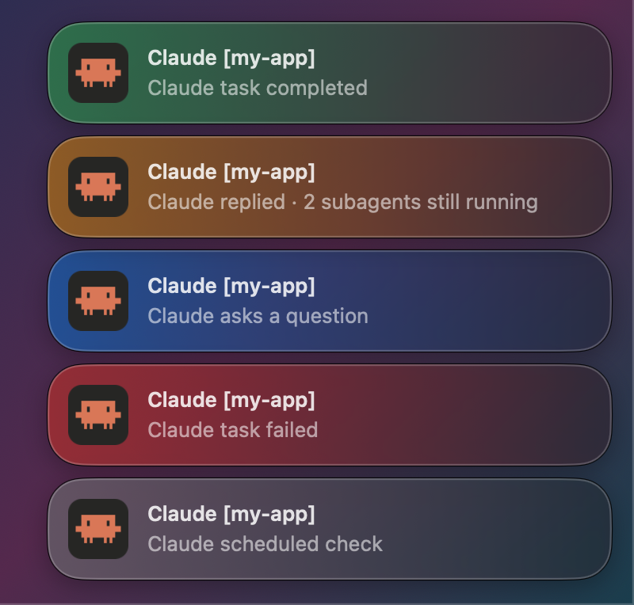
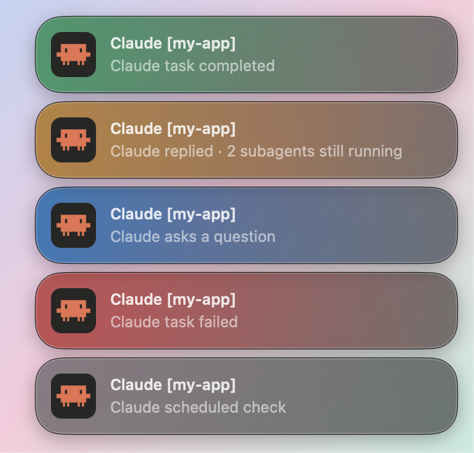
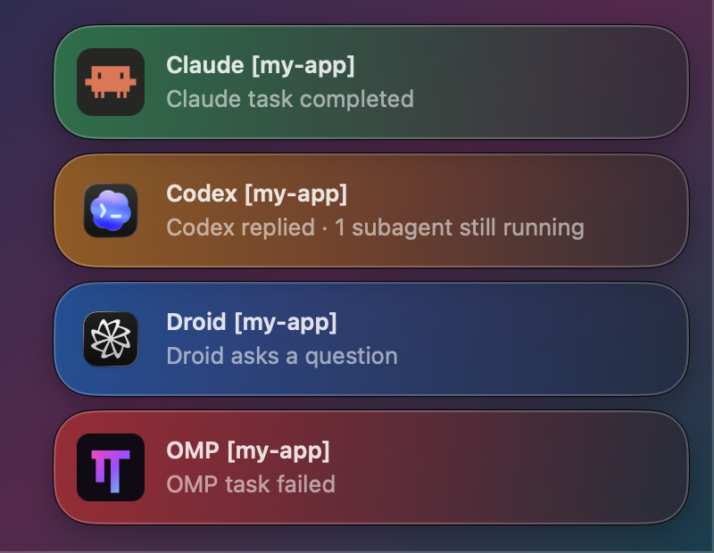
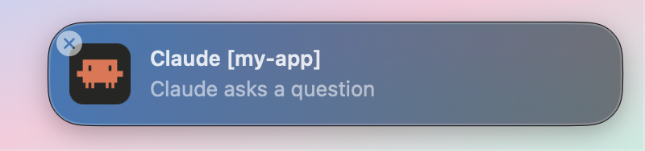

# agent-notification-sound

macOS notifications for coding agents that tell you *why* they pinged. A finished task, a subagent that is still running, a question and a cron tick each get their own message, color and sound, so you stop switching windows for nothing.

Works with Claude Code, Codex CLI, Factory Droid, Oh My Pi (OMP) and Grok.

<p align="center">
  
  
</p>

## Notification classes

| Class | Example message | Color | Sound |
|---|---|---|---|
| Done | `Claude task completed` | green | `fx-ok01.wav` |
| Still running | `Claude replied · 2 subagents still running`<br>`Claude subagent finished · 1 shell still running` | orange | Tink |
| Question | `Claude asks a question` | blue | Submarine |
| Failed | `Claude task failed` | red | Basso |
| Quiet | `Claude scheduled check`, `Claude monitor event`, `Codex goal step`, `OMP loop run` | grey | none |

The title is always `<Agent> [<folder>]`. "Done" only fires when the main agent has finished and nothing it started is still running. When the last background task finishes and the agent wraps up, that turn counts as done.

Permission prompts, idle reminders and turns you interrupt stay silent.

## Supported agents

<p align="center">
  
</p>

| Agent | Hooked into | Done | Still running | Question | Failed | Quiet |
|---|---|---|---|---|---|---|
| Claude Code | `~/.claude/settings.json` | ✓ | subagents, shells, workflows | `AskUserQuestion` | ✓ | cron/loop, Monitor events |
| Codex CLI | `~/.codex/hooks.json` | ✓ | subagents | `request_user_input` | — | `/goal` steps |
| Factory Droid | `~/.factory/hooks.json` | ✓ | subagents, background commands | `AskUser` | — | Loop/cron prompts |
| Oh My Pi | extension in `~/.omp/agent/extensions/` | ✓ | async jobs (subagents, shells) | `ask` | ✓ | `/loop` runs |
| Grok | `~/.grok/hooks/` | ✓ | — | `ask_user_question` | ✓ | — |

A dash means the agent has no event for it. Codex and Droid don't report failed turns, and Grok doesn't expose background work.

### How each agent's classes are detected

- **Claude Code**: `turnOrigin` in the transcript says whether you, a finished background task or a cron job started the turn. `background_tasks` in the `Stop` input lists what is still running. Monitors are long-lived watchers, so they don't count as running work.
- **Codex**: a turn with no user message while a `/goal` is active is a goal step. Codex doesn't list running subagents, so the hook keeps a count from `SubagentStart` and `SubagentStop`. Only the terminal app notifies. `codex exec` runs and the ChatGPT/Codex desktop app, which has its own notifications, stay quiet.
- **Droid**: the last user message in the transcript is checked. An `execute-completion:` id means a background command, "Background task completed." means a subagent, and text equal to one of the session's cron prompts means a Loop tick. `background-processes.json` and `task-invocations.json` show what still runs.
- **OMP**: an `async-result` message means a background job finished, and the same prompt twice in a row means a `/loop` run. `ctx.getAsyncJobSnapshot()` shows what still runs.

## The banner

macOS Notification Center banners can't be colored, so this repo draws its own: a Liquid Glass panel (`overlay/Overlay.swift`) in the top-right corner with the agent's icon and a tint that fades from the icon side.

<p align="center">
  
</p>

It behaves like a normal banner:

- fades out after 5 seconds (3.5 for grey)
- stays while the pointer is on it and shows a close button
- closes on click or a two-finger swipe to the right
- stacks when several arrive at once
- never takes focus from the app you are using

These banners don't go to Notification Center. Every notification is logged to `~/Library/Logs/agent-notify.log`, so you can check what an earlier ping was:

```
2026-11-01 00:49:09	progress	Claude [dev]	Claude replied · 1 shell still running
```

On macOS before 26 the panel uses a regular blur. If `swiftc` is missing, everything falls back to the plain macOS banner.

## Install

```bash
git clone https://github.com/0xRafie/agent-notification-sound ~/agent-notification-sound
~/agent-notification-sound/install.sh
```

Needs macOS, `jq` (ships with macOS) and the Xcode Command Line Tools for `swiftc` (`xcode-select --install`).

`install.sh` builds the banner and adds hooks for every agent it finds. Running it again is safe: it replaces its own older hooks and leaves your other hooks alone. The hooks run scripts from this folder, so keep the clone where it is, or run `install.sh` again after moving it.

After installing:

- **Claude Code**: open `/hooks` once, or restart the session.
- **Codex**: open `/hooks` and trust the new hooks. Codex skips new hooks until you do.
- **OMP**: restart running sessions.
- **Droid and Grok**: nothing to do.

`fx-ok01.wav` is read from `~/.factory/sounds/`. If it isn't there, macOS Glass plays instead.

## Configuration

- **Messages and sounds** live at the top of `notify.sh`, and in the header of `omp/index.ts` for OMP. OMP can also be configured from `~/.omp/agent/config.yml`.
- **Colors and timing** of the banner live in `overlay/Overlay.swift`. Run `install.sh` again to rebuild after changing them.
- **Icons** are in `icons/`. Droid and Grok use their app's own icon.

## Tests

```bash
./test.sh
```

Runs every class for every agent against fixture transcripts in dry-run mode (`NOTIFY_DRY_RUN=1`), so nothing pops up. The OMP cases need [bun](https://bun.sh).

## Files

```
notify.sh             hook for Claude Code, Codex, Droid and Grok
omp/index.ts          OMP extension
overlay/Overlay.swift glass banner, built into bin/notify-overlay
icons/                Claude Code (Clawd), Codex and OMP icons
install.sh            builds the banner and wires the hooks
test.sh               dry-run tests
docs/                 screenshots for this README
```

## Credits

The icons belong to their owners: Clawd and Claude Code to Anthropic, Codex to OpenAI (taken from the ChatGPT app), OMP to the oh-my-pi project (omp.sh), and Droid's icon is read from the installed Factory app. They are here only to label each agent's notifications.

This repo replaces `droid-notification-sound` and `omp-notification-sound`.
